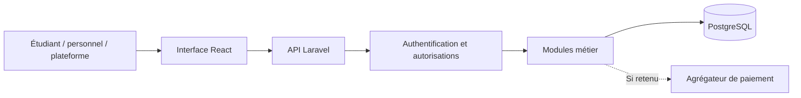

# Mon Miam Miam - Choix techniques et architecture

Groupe 4 - ULC-ICAM, RDC. Version de travail du 20 octobre 2026.

Statut : proposition de référence préparée pour la tâche Jira [MMM-24](https://legroupea.atlassian.net/browse/MMM-24), à relire avec le groupe et l’encadrant. Le groupe a confirmé plusieurs restaurants dès la première version. Le cahier des charges cite React, Vue.js ou Angular pour les interfaces et PHP/Laravel pour le serveur ; React et Laravel sont retenus parmi ces indications. Les outils explicitement demandés sont conservés. PostgreSQL et les outils complémentaires sont des choix de réalisation. Le groupe confirme avoir étudié les technologies envisagées et demande de suivre prioritairement les indications du cahier des charges.

## 1. Solution proposée

| Partie | Choix | Rôle dans le projet |
|---|---|---|
| Interface web | React, TypeScript et Vite | Réaliser les parcours étudiant, restaurant et plateforme, adaptés au téléphone. |
| Serveur | Laravel 13, avec PHP compatible (8.3 minimum ; version exacte à fixer lors de la préparation) | Fournir une API REST, valider les données, appliquer les droits et exécuter les règles métier. |
| Base de données | PostgreSQL, version encore supportée à fixer à l’installation | Conserver les comptes, restaurants, menus, commandes, réclamations et mouvements de points. |
| Connexion | Laravel Sanctum, sessions/cookies pour l’application web | Identifier les utilisateurs ; les autorisations par restaurant restent des contrôles distincts côté serveur. |
| Maquettes | Figma | Définir les écrans et le parcours avant leur programmation. |
| Tests | Tests Laravel et tests de parcours avec Playwright | Vérifier les calculs, les droits, les API et les parcours complets sur deux restaurants. |
| Collaboration | Git, GitHub et Jira | Historique, relecture du travail, suivi des tâches et preuves de réalisation. |
| Démonstration d’interface | Vercel pour le frontend Vite | Publier les interfaces ; l’hébergement du serveur Laravel et de la base est une décision séparée. |

### Pourquoi cette organisation ?

Un frontend et un serveur central, organisés en modules, suffisent pour le projet. Les binômes B et C peuvent collaborer à partir d’un contrat d’API explicite. Plusieurs restaurants ne nécessitent pas plusieurs applications ni un serveur par restaurant. On évite pour cette première version la complexité d’une architecture en microservices.

Le groupe confirme avoir déjà utilisé ces technologies en cours. La configuration de la connexion entre frontend et API, le contrôle des rôles et les tests restent à réaliser et à documenter.

## 2. Architecture de fonctionnement

Le navigateur affiche les informations ; le serveur décide si une action est autorisée et recalcule les montants. La base conserve les faits. Le navigateur ne décide ni du prix final ni des restaurants auxquels un employé peut accéder.

Modules proposés : comptes et accès ; restaurants et rattachements ; catalogue ; panier/commandes ; réclamations ; fidélité/parrainage ; promotions/statistiques ; paiement facultatif selon arbitrage du professeur.

## 3. Séparer les restaurants

- Un compte étudiant peut passer des commandes dans différents restaurants et consulter son propre historique.
- Les comptes de personnel reçoivent des rôles via un rattachement explicite à un restaurant. Le cumul des rôles ou de plusieurs rattachements reste à valider.
- Un rôle de plateforme distinct autorise les opérations globales définies dans la matrice des droits.
- Menus, commandes, réclamations, paramètres et statistiques possèdent un contexte de restaurant. Il doit être vérifié côté serveur sur chaque action.
- Le fait qu’un restaurant apparaisse dans l’URL ou dans l’interface ne suffit pas à autoriser l’accès.
- Une base partagée est proposée. Les contraintes et références entre tables doivent empêcher qu’une ligne de commande du restaurant A pointe vers un article de B. L’ajout d’un champ `restaurant_id` ne constitue pas à lui seul une protection.
- Le paiement et le règlement appartiennent à une commande. Les états du paiement et de la commande restent séparés.
- Panier et commande par restaurant : recommandation à valider avant implémentation ; ne pas fusionner silencieusement plusieurs restaurants.

## 4. Première structure des données

Cette liste prépare la tâche MMM-25 et MR04 / MMM-48. Elle n’est pas encore un schéma de base définitif.

| Ensemble | Données principales | Point de contrôle |
|---|---|---|
| Utilisateurs | Identité, contact, mot de passe haché, statut | Un étudiant ne lit pas les commandes d’un autre. |
| Restaurants | Nom, statut, horaires et paramètres | La désactivation bloque les nouvelles commandes et conserve l’historique. |
| Rattachements | Utilisateur, restaurant, rôle local, statut | Les droits viennent du rattachement contrôlé, pas d’un choix libre dans la requête. |
| Articles du menu | Restaurant, nom, prix FC, disponibilité | Les articles de différents restaurants ne se mélangent pas dans une commande. |
| Commandes et lignes | Étudiant, restaurant, mode de service, états, prix appliqués et quantités | Recalcul serveur, prix conservés et transitions autorisées. |
| Réclamations | Commande, auteur, état et réponses | Accès du client concerné et des responsables autorisés. |
| Mouvements de points | Compte, restaurant ou portée approuvée, commande, crédit/débit | Événement traité une fois ; solde cohérent ; corrections traçables. |
| Parrainages | Parrain, filleul, code et récompense | Portée locale ou globale à valider ; un seul bonus pour l’événement prévu. |
| Paiements, si retenus | Commande, montant CDF, référence externe, état | Confirmation serveur et prévention des traitements en double. |

Utiliser des montants décimaux à précision fixée et documenter les arrondis ; ne pas calculer les prix avec des nombres flottants approximatifs. L’échelle et le format d’affichage des FC seront précisés lors de la modélisation, sans convertir les montants du CDC.

## 5. Hébergement et authentification

Le frontend Vite peut être démontré sur Vercel. Le serveur Laravel doit disposer d’un environnement PHP compatible et la base PostgreSQL d’un hébergement persistant. Aucun fournisseur backend, achat, abonnement ni coût n’est engagé à ce stade.

Pour la version intégrée, privilégier une origine web commune pour l’interface et l’API afin de simplifier la session. Une autre option consiste à utiliser des sous-domaines d’un même domaine principal avec la configuration CORS/cookies adaptée. Sanctum exige ce domaine principal commun pour son mode SPA à cookies. Ne pas supposer qu’une interface sur `vercel.app` et une API sur un domaine fournisseur indépendant fonctionneront sans adaptation.

Une démonstration Vercel avec des données d’exemple doit être présentée comme une maquette. Elle ne remplace pas un test de l’application complète avec l’API et la base.

## 6. Préparation des postes et collaboration

Vérification effectuée sur le poste de Michael : PHP actif 8.0.30, Composer 2.10.3, Node.js 24.19.0, Git disponible. Le client MariaDB inclus dans XAMPP annonce 10.4.32 ; cela ne confirme ni un serveur actif ni une base PostgreSQL installée. Aucun logiciel n’a été installé ou remplacé par cette étape.

PHP 8.0 ne permet pas d’exécuter Laravel 13. Préparer une version PHP compatible avant de créer le serveur, de préférence dans un environnement de projet distinct de l’ancien XAMPP pour éviter de perturber les exercices existants. Fixer les mêmes versions sur les postes du groupe et dans l’intégration continue.

Structure de dépôt proposée : `frontend/`, `backend/`, `docs/`, `.github/workflows/`. Un dépôt principal du groupe avec des forks personnels est proposé, sous réserve que cette organisation réponde à la consigne exacte du professeur sur les dépôts individuels.

Chaque membre utilise son identité Git/GitHub personnelle, même si l’adresse Jira est différente. Les branches et demandes d’intégration citent une vraie clé Jira. La documentation de conception doit également être versionnée. Les secrets, fichiers `.env`, mots de passe et données réelles de clients ne sont pas stockés dans le dépôt.

## 7. Travail des binômes à cette étape

| Binôme | Travail immédiat | Preuve à montrer |
|---|---|---|
| A : Moise et Lucas | Relire les règles, préparer la matrice des droits et les maquettes | Document de décisions et lien Figma ; MMM-8, MMM-9, MMM-45. |
| B : Michael et Assek | Concevoir sélection du restaurant et écrans des rôles | Parcours et interfaces ; MMM-46, MMM-47, MMM-53. |
| C : Ryan et Yedidia | Modéliser restaurants, rattachements et commandes ; définir les API | Schéma relationnel et contrat d’API ; MMM-25, MMM-48, MMM-49. |
| D : Prudent et Moise | Préparer les postes, la collaboration et les tests sur deux restaurants | Guide d’installation, conventions Git et plan de tests ; MMM-39, MMM-40, MMM-55. |

La tâche de choix technique peut passer en revue lorsque le groupe dispose de cette proposition, comprend ses contraintes et peut la confronter aux consignes de cours. Les tests applicatifs et le déploiement n’ont pas encore été réalisés.

## 8. Références officielles

- [Versions Laravel et exigences PHP](https://laravel.com/framework/docs/releases)
- [Authentification Laravel](https://laravel.com/framework/docs/13.x/authentication)
- [Sanctum et connexion SPA](https://laravel.com/framework/docs/13.x/sanctum)
- [Bases prises en charge par Laravel](https://laravel.com/framework/docs/13.x/database)
- [React avec Vite](https://react.dev/learn/build-a-react-app-from-scratch)
- [Déploiement Vite sur Vercel](https://vercel.com/docs/frameworks/frontend/vite)
- [Versions PostgreSQL supportées](https://www.postgresql.org/support/versioning/)

## 9. Correspondance avec le cahier des charges

| Indication du CDC | Réalisation retenue / proposée |
|---|---|
| Application web, plusieurs navigateurs, évolution plusieurs restaurants | Web adapté au téléphone, plusieurs restaurants dès la V1 selon la précision du Groupe 4. |
| MVC ou architecture similaire | Laravel pour modèles, contrôleurs et règles ; React pour les vues ; échanges documentés par API. |
| Frontend moderne : React, Vue.js ou Angular cités en exemple | React retenu parmi les exemples. TypeScript et Vite sont des choix d’outillage complémentaires. |
| PHP et Laravel cités pour le backend | PHP/Laravel retenus ; version compatible à préparer. |
| Base de données | PostgreSQL proposé ; le CDC ne nomme pas de moteur obligatoire. |
| Tableaux actualisés en AJAX | Requêtes asynchrones des écrans React vers l’API Laravel ; fréquence d’actualisation à définir. |
| Jira, GitHub et branches Git | Suivi dans le projet MMM ; documentation et code versionnés ; relecture des contributions. |
| Figma et Vercel | Maquettes Figma puis démonstration web sur Vercel ; serveur et base à héberger séparément ou architecture intégrée adaptée. |
| Tests unitaires, fonctionnels et de bout en bout | Tests Laravel et Playwright proposés ; les catégories de tests sont demandées, ces outils de test particuliers ne sont pas imposés. |
| Étape CI/CD, GitHub Actions cité en exemple | GitHub Actions proposé pour automatiser les vérifications et déploiements configurés. |
| Couleurs #cfbd97 et #000000 | Charte à appliquer aux maquettes et interfaces. |

Les noms figurant dans la liste de ressources du CDC ne deviennent pas tous des dépendances obligatoires. Les taux de fidélité illustratifs et le paiement indiqué comme bonus restent soumis aux décisions métier documentées.

Mise à jour Jira : la proposition et sa correspondance au CDC sont enregistrées dans MMM-24, placé en état **En revue**. La validation de conception et les installations restent à effectuer.
