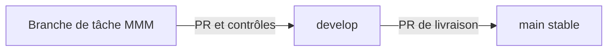

# Branches, revue et protection de main

## Organisation

Les branches n'ont pas vocation à séparer définitivement les membres ; elles isolent des changements précis. Les responsabilités figurent dans le document dédié. Les branches de départ créées ne signifient pas que les fonctionnalités sont développées.

## Protection serveur : état constaté

Le 22/10/2026, l'API GitHub a retourné **HTTP 403 : “Upgrade to GitHub Pro or make this repository public to enable this feature.”** pour la protection de main. Le dépôt reste privé ; aucune publication publique et aucun abonnement ne sont engagés.

Créer develop et des branches de tâches ne protège pas techniquement main. Les vérifications de PR et les consignes de revue réduisent les erreurs, mais un collaborateur autorisé peut encore contourner la procédure tant qu'une protection serveur n'est pas disponible. Aucune protection active n'est déclarée.

## Configuration cible quand l'offre le permettra

- main et develop : exiger une PR et au moins une approbation d'un autre membre ; invalider les approbations lors de nouveaux changements.
- Exiger frontend, backend, documentation et conventions comme contrôles réussis ; résoudre les conversations avant fusion.
- Interdire les push forcés et suppressions ; appliquer la règle aux administrateurs également.
- main : intégrer les livraisons depuis develop ; garder develop à jour après les correctifs.
- Conserver les commits individuels par merge normal ; ne pas activer une fusion payante ou une publication publique pour contourner cette limite.

Le fichier CODEOWNERS indique les personnes à solliciter. Il ne remplace pas les protections de branche et ne prouve pas qu'une revue a eu lieu. La synchronisation Jira/GitHub n'est pas configurée : reporter manuellement les liens et décisions.

Source officielle : https://docs.github.com/en/repositories/configuring-branches-and-merges-in-your-repository/managing-protected-branches/about-protected-branches
