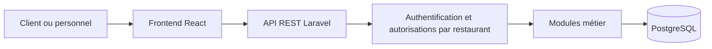

# Architecture de référence proposée

Groupe 4 · ULC-ICAM · RDC. Proposition à relire, suivi [MMM-24](https://legroupea.atlassian.net/browse/MMM-24) et [MMM-25](https://legroupea.atlassian.net/browse/MMM-25).

## Vue générale

Un frontend, un backend modulaire et une base partagée suffisent ; il n'est pas prévu un serveur par restaurant. React porte les vues, Laravel les contrôleurs, modèles, validations et règles. Les tableaux se mettent à jour avec des requêtes asynchrones.

## Répartition technique

| Partie | Choix proposé | Responsabilité |
|---|---|---|
| Interface | React, TypeScript, Vite | Binôme B |
| Serveur | Laravel 13, PHP 8.5 sur le poste et la CI | Binôme C |
| Données | PostgreSQL, montants décimaux CDF | Binôme C |
| Authentification prévue | Sanctum en mode SPA, session et CSRF | Binôme C avec B |
| Vérifications et livraison | GitHub Actions, PHPUnit et Vitest ; E2E à compléter | Binôme D |

## Modules cible

Comptes et accès ; restaurants et rattachements ; menus ; devis et commandes ; réclamations ; statistiques ; fidélité/parrainage ; promotions et compléments. Le paiement reste conditionnel à l'arbitrage de périmètre.

## Frontière entre restaurants

Les données métier portent leur restaurant. Chaque requête vérifie l'identité, la propriété d'une commande et le rattachement actif du personnel. Les références composées empêchent de rattacher un article de B à une commande de A. Le serveur recalcule les montants, valide les transitions et traite les confirmations répétées sans double commande.

Les sessions/cookies Sanctum demandent une origine commune ou des sous-domaines compatibles. Le déploiement de l'interface sur Vercel ne configure pas automatiquement l'hébergement Laravel, PostgreSQL et les cookies entre domaines.

## Documents détaillés

- [Dossier d'architecture PDF](Architecture_Groupe_4.pdf) et [proposition détaillée datée](../Architecture_proposee.md).
- [Modèle relationnel Mermaid](../conception/Modele_Relationnel.mmd).
- [Dictionnaire des données](../conception/Dictionnaire_Donnees.csv).
- [Contrat OpenAPI P0](../conception/Contrat_API_P0_OpenAPI.json), 33 opérations proposées.
- [Extensions fidélité et parrainage](../conception/Extensions_Fidelite_Parrainage.md).

Ces documents décrivent la cible. Les migrations métier, la base dédiée, Sanctum et les API métier ne sont pas encore implémentés. Les contrôles initiaux ne prouvent pas l'isolation multi-restaurants.
