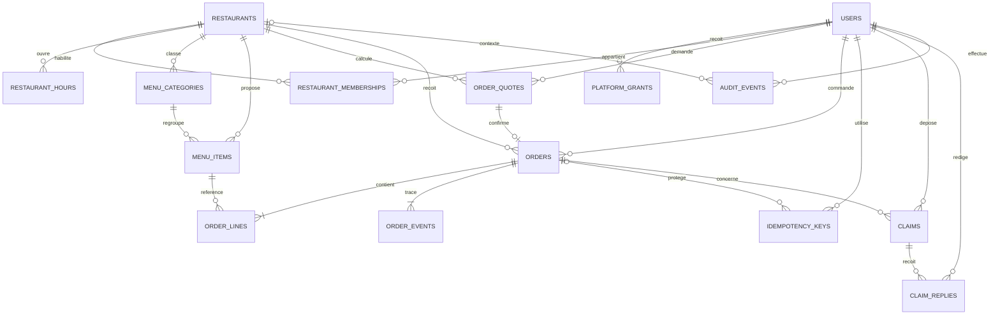

# Mon Miam Miam - Modélisation des données et API

Groupe 4 · ULC-ICAM · RDC · 21 octobre 2026 · Proposition v0.1 pour MMM-25 / MMM-48 / MMM-49.

**Statut :** conception préparée pour revue. La maquette principale est navigable, sans validation complète des quatre espaces. Aucun serveur, migration, base ou dépôt GitHub créé par ce dossier. Le CDC reste la référence des besoins ; les tables, champs, URL, états et limites sont des propositions techniques. Plusieurs restaurants dès la V1 et CDF/FC sans conversion sont confirmés par le groupe.

## 1. Comprendre cette étape

La base conserve les informations et leurs liens. Le modèle conceptuel explique les relations ; le modèle logique les traduit en tables et clés. Le contrat API indique ce que React envoie à Laravel et reçoit en retour. Un identifiant n’est jamais une autorisation.

## 2. Modèle relationnel du socle P0

Notation : `||` = un ; `o{` = zéro à plusieurs ; `|{` = un à plusieurs ; `o|` = zéro ou un. Les relations montrent le besoin métier, pas toutes les contraintes physiques. Une commande doit avoir au moins une ligne et un événement : exigence transactionnelle, non garantie par la seule clé étrangère. Les rattachements autorisent plusieurs restaurants ; le rôle local unique reste proposé.

## 3. Dictionnaire logique

Les champs `created_at` et `updated_at` sont prévus sur les tables modifiables ; événements et audit utilisent des dates immuables. PK = clé primaire ; FK = clé étrangère. Les types décrivent la cible PostgreSQL, pas une migration déjà exécutée.

### users - Comptes communs

id bigint PK ; name varchar(150) ; email varchar(254) ; phone varchar(32) ; password_hash varchar(255) ; status active/suspended ; email_verified_at timestamptz nullable.

Email normalisé unique ; mot de passe haché ; aucun rôle accepté à l’inscription.

### platform_grants - Pouvoirs globaux explicites

id bigint PK ; user_id FK users ; role platform_admin ; active boolean.

Une attribution active par utilisateur/rôle ; provisionnement réservé à une procédure autorisée, jamais à l’inscription publique.

### restaurants - Établissements

id bigint PK ; name varchar(150) ; status active/inactive ; timezone varchar(64) ; address text ; delivery_enabled boolean ; settings_version integer.

Fuseau IANA à confirmer pour chaque site ; la RDC ne doit pas être réduite implicitement à un seul fuseau. Désactivation sans effacement des commandes.

### restaurant_memberships - Rattachements et droits locaux

id bigint PK ; restaurant_id FK ; user_id FK ; role employee/manager/restaurant_admin ; active boolean.

Unique (restaurant_id,user_id) : un rôle local par compte et restaurant proposé ; plusieurs restaurants possibles par rattachements distincts.

### restaurant_hours - Plages d’ouverture

id bigint PK ; restaurant_id FK ; weekday smallint ; opens_at time ; closes_at time.

Jour 1 à 7 ; début avant fin ; plusieurs plages autorisées sans chevauchement. Une fermeture hebdomadaire correspond à aucune plage. Plages de nuit à scinder à minuit ; exceptions à compléter.

### menu_categories - Classement du menu

id bigint PK ; restaurant_id FK ; name varchar(100) ; position integer ; active boolean.

Unique (id,restaurant_id) pour les références composées ; archivage logique.

### menu_items - Articles de chaque restaurant

id bigint PK ; restaurant_id FK ; category_id bigint ; name varchar(150) ; description text ; price numeric(18,2) ; available boolean ; archived_at timestamptz nullable ; version integer.

Prix non négatif ; FK (category_id,restaurant_id) vers menu_categories(id,restaurant_id). L’indisponibilité ne supprime pas l’article historique.

### order_quotes - Récapitulatifs temporaires calculés par le serveur

id uuid PK ; restaurant_id FK ; user_id FK ; payload jsonb ; subtotal/discount/delivery_fee/total numeric(18,2) ; currency CDF ; expires_at timestamptz ; fingerprint varchar(128).

Payload de devis temporaire : articles, quantités, prix et service validés. Expiration proposée : 10 minutes, à valider. Ne réserve pas les articles. Unique (id,restaurant_id,user_id).

### orders - Commandes et informations au moment de l’achat

id bigint PK ; restaurant_id FK ; customer_id FK users ; quote_id uuid ; reference varchar(40) ; service_mode on_site/delivery ; arrival_at timestamptz nullable ; delivery_snapshot jsonb nullable ; status varchar(32) ; payment_state varchar(32) ; subtotal/discount/delivery_fee/total numeric(18,2) ; currency CDF ; version integer.

Unique quote_id : un devis ne produit qu’une commande. FK (quote_id,restaurant_id,customer_id) vers order_quotes(id,restaurant_id,user_id). Unique (restaurant_id,reference) et (id,restaurant_id). Adresse/contact de livraison copiés et privés.

### order_lines - Détail immuable du prix appliqué

id bigint PK ; restaurant_id bigint ; order_id bigint ; menu_item_id bigint ; item_name varchar(150) ; unit_price numeric(18,2) ; quantity integer ; line_total numeric(18,2).

FK (order_id,restaurant_id) vers orders ; FK (menu_item_id,restaurant_id) vers menu_items ; quantité 1 à 99 proposée ; ligne = prix unitaire × quantité ; unique (order_id,menu_item_id).

### order_events - Historique des états

id bigint PK ; restaurant_id bigint ; order_id bigint ; actor_id FK users ; from_status nullable ; to_status varchar(32) ; reason text nullable ; order_version integer ; occurred_at timestamptz.

FK composée vers la commande ; unique (order_id,order_version). Événements append-only ; auteur issu de la session, jamais imposé par le client.

### idempotency_keys - Protection contre les doubles créations

id bigint PK ; user_id FK ; scope varchar(150) ; key uuid ; request_hash varchar(128) ; order_id FK nullable ; response_code integer nullable ; expires_at timestamptz.

Unique (user_id,scope,key). Réservation et commande dans la même transaction ; même clé/contenu rejoué, contenu différent refusé. Conservation proposée : 24 h ; le devis unique protège aussi après expiration de la clé.

### claims - Réclamations du client

id bigint PK ; restaurant_id bigint ; order_id bigint ; author_id FK users ; subject varchar(150) ; message text ; status open/awaiting_approval/resolved.

FK composée vers orders ; auteur doit être le propriétaire de la commande, contrôle serveur. Délai et nombre de réclamations à valider.

### claim_replies - Réponses soumises à validation

id bigint PK ; restaurant_id bigint ; claim_id bigint ; author_id FK users ; body text ; state draft/submitted/approved/rejected ; reviewer_id FK users nullable ; reviewed_at timestamptz nullable.

FK composée vers claims ; brouillon non visible au client ; publication après approbation du gérant. Rejet et corrections traçables ; règle d’auto-approbation à interdire par défaut proposé.

### audit_events - Trace des opérations sensibles

id bigint PK ; restaurant_id FK nullable ; actor_id FK users ; action varchar(100) ; target_type varchar(60) ; target_id varchar(64) ; metadata jsonb ; occurred_at timestamptz.

Restaurant nul uniquement pour une action globale autorisée. Ne pas journaliser mots de passe, cookies, jetons ni adresses complètes. Durée et accès aux journaux à valider.

## 4. Intégrité et séparation des restaurants

- Ajouter une clé unique (id,restaurant_id) aux entités référencées par des FK composées : catégories, articles, commandes, réclamations. Relier une ligne de commande à la commande ET à l’article avec le même restaurant. Même principe pour une réponse de réclamation et sa réclamation.

- Contraintes de ligne : prix et frais non négatifs, quantité positive, réduction entre zéro et le sous-total, total = sous-total - réduction + livraison, montant CDF fixé. Vérifier la cohérence des sommes de lignes dans la transaction : un CHECK de ligne ne garantit pas une somme inter-tables.

- À chaque requête privée : compte actif, rattachement actif, rôle autorisé et ressource appartenant au restaurant demandé. Un client est limité à ses propres commandes. Masquer une ressource interdite par 404 lorsque nécessaire ; ne pas révéler ses données dans le message.

- Archiver articles et établissements ; préserver les commandes et prix historiques. Politique de conservation/anonymisation et obligations applicables à faire confirmer ; aucune durée juridique inventée.

- Index proposés : memberships(user_id,restaurant_id), menu_items(restaurant_id,available), orders(restaurant_id,status,created_at), orders(customer_id,created_at), claims(restaurant_id,status), order_events(order_id,occurred_at). Examiner les requêtes réelles avant d’en ajouter.

- NUMERIC(18,2) et montants JSON sous forme de texte sont proposés. Ne pas utiliser des flottants approximatifs pour les calculs. Échelle d’affichage, arrondi et limites à valider avant les migrations.

## 5. Confirmation et concurrence

1. Le client demande un devis pour les articles d’un restaurant, le mode de service et les informations nécessaires. Le serveur calcule prix, remises et livraison autorisés.

2. Le serveur conserve un devis limité dans le temps avec son contenu et les versions des règles/articles. Le devis ne réserve aucun article.

3. La confirmation envoie uniquement quote_id, une note éventuelle et une clé Idempotency-Key. Ne pas accepter customer_id, restaurant arbitraire, rôle ou total imposé par le client.

4. Dans une transaction : réserver la clé, verrouiller le devis et les lignes/version nécessaires, revalider les droits, ouverture, mode, prix et disponibilité, puis créer commande, lignes et événement initial ensemble. En cas de changement : 409, aucun débit/commande, nouveau récapitulatif à confirmer.

5. La commande reprend les données validées et les prix appliqués. UNIQUE(quote_id) empêche un second achat du même devis ; une commande intentionnellement nouvelle exige un nouveau devis.

6. Même clé et même requête : retourner la commande existante (200), sans nouveau journal ni récompense. Même clé avec autre contenu : 409. Deux traitements concurrents ne doivent pas produire deux commandes. Le rejeu autorisé est contrôlé avant le refus pour expiration du devis.

7. Une transition d’état exige expected_version ; seule la première écriture compatible réussit. La version suivante et son événement sont enregistrés ensemble. Les mécanismes de verrous et index devront être testés dans PostgreSQL.

## 6. États proposés et droits à valider

Commande : pending → accepted → preparing → ready → completed (sur place). En livraison : ready → out_for_delivery → completed. Refus : pending → rejected. Annulation : pending/accepted → cancelled par un responsable autorisé, motif et politique à confirmer. États terminaux sans retour direct ; toute correction administrative doit être une opération tracée, pas une modification libre du statut.

Personnel employé : accepter, préparer, marquer prête et confirmer le service selon habilitation. Gérant : supervision et approbation des réponses de réclamation. Administrateur local : gestion du menu et des employés. Création de comptes employés par gérant et administrateur local, avec rôle employee imposé. Attribution de gérant/administrateur local par plateforme proposée ; pas d’élévation libre de ses propres droits.

L’état de paiement est indépendant. Initialement unrecorded si aucun règlement n’est enregistré ; terminer une commande ne prouve pas qu’elle est payée. Encaissement manuel, intégration, remboursement et effets sur points restent à valider.

Réclamation : open → awaiting_approval lors de la soumission d’une réponse ; approbation du gérant → réponse publiée et resolved ; rejet → réponse rejetée et retour open. Le client ne lit que les réponses approuvées. Aucune auto-approbation par défaut proposé.

## 7. Contrat API P0

Le fichier OpenAPI JSON décrit les requêtes, réponses et erreurs. Chemin proposé : /api/v1 ; CSRF à la racine /sanctum/csrf-cookie. Session/cookies Sanctum et X-XSRF-TOKEN sur les écritures. Nom mmm_session proposé, à configurer ; origine commune ou sous-domaines d’un même domaine principal. Aucune route n’est déployée.

Les listes sont paginées. Les erreurs utilisent error.code, error.message et éventuellement error.fields. 401 = connexion ; 403 = droit ; 404 = absence/ressource masquée ; 409 = conflit/devis/version ; 419 = session/CSRF Laravel ; 422 = validation ; 429 = débit. Aucun détail SQL, cookie ou information d’un autre restaurant dans les erreurs.

| Méthode | Chemin | Action / droit |
|---|---|---|
| GET | `/sanctum/csrf-cookie` | Initialiser la protection CSRF - Public |
| POST | `/auth/register` | Créer un compte client - Public |
| POST | `/auth/login` | Ouvrir une session - Public |
| POST | `/auth/forgot-password` | Demander un lien de récupération - Public |
| POST | `/auth/reset-password` | Réinitialiser par lien reçu - Public |
| POST | `/auth/logout` | Fermer la session - Connecté |
| GET | `/me` | Lire son profil et ses rattachements - Connecté |
| GET | `/restaurants` | Lister les restaurants visibles - Public |
| GET | `/restaurants/{restaurantId}/menu` | Consulter le menu public - Public |
| POST | `/restaurants/{restaurantId}/order-quotes` | Calculer un récapitulatif serveur - Client connecté |
| POST | `/restaurants/{restaurantId}/orders` | Confirmer un devis et créer une commande - Client propriétaire du devis |
| GET | `/me/orders` | Lister ses propres commandes, tous restaurants - Client connecté |
| GET | `/me/orders/{orderId}` | Lire sa propre commande - Propriétaire uniquement |
| GET | `/restaurants/{restaurantId}/orders` | Lister les commandes du restaurant - Personnel rattaché et actif |
| GET | `/restaurants/{restaurantId}/orders/{orderId}` | Lire une commande du restaurant - Personnel rattaché et actif |
| POST | `/restaurants/{restaurantId}/orders/{orderId}/transitions` | Changer un état autorisé - Personnel ; matrice des droits |
| POST | `/restaurants/{restaurantId}/menu-items` | Créer un article - Administrateur local |
| PATCH | `/restaurants/{restaurantId}/menu-items/{itemId}` | Modifier un article - Administrateur local |
| POST | `/restaurants/{restaurantId}/menu-items/{itemId}/archive` | Archiver sans effacer les lignes historiques - Administrateur local |
| PATCH | `/restaurants/{restaurantId}/menu-items/{itemId}/availability` | Changer la disponibilité - Employé, gérant ou administrateur local |
| GET | `/restaurants/{restaurantId}/categories` | Lister les catégories visibles - Public |
| POST | `/restaurants/{restaurantId}/categories` | Créer une catégorie - Administrateur local |
| POST | `/restaurants/{restaurantId}/employees` | Créer un accès employé - Gérant ou administrateur local |
| PATCH | `/restaurants/{restaurantId}/memberships/{userId}` | Activer ou retirer un accès employé - Administrateur local uniquement |
| POST | `/me/orders/{orderId}/claims` | Déposer une réclamation - Propriétaire de la commande |
| GET | `/me/claims` | Lire ses réclamations et réponses publiées - Client connecté |
| GET | `/restaurants/{restaurantId}/claims` | Lister les réclamations du restaurant - Personnel rattaché |
| POST | `/restaurants/{restaurantId}/claims/{claimId}/replies` | Proposer une réponse à approuver - Employé rattaché |
| POST | `/restaurants/{restaurantId}/replies/{replyId}/review` | Approuver ou rejeter la réponse - Gérant rattaché |
| GET | `/restaurants/{restaurantId}/sales-summary` | Lire les ventes du restaurant - Personnel ; portée selon rôle |
| POST | `/platform/restaurants` | Créer un restaurant - Administrateur de plateforme |
| PATCH | `/platform/restaurants/{restaurantId}` | Activer ou désactiver un restaurant - Administrateur de plateforme |
| POST | `/platform/restaurants/{restaurantId}/managers` | Rattacher un responsable - Administrateur de plateforme |

## 8. Correspondance avec Figma

Liste restaurants → GET /restaurants ; menu → GET /restaurants/{restaurantId}/menu ; panier/récapitulatif → POST order-quotes ; confirmer → POST orders ; suivi → GET /me/orders/{orderId} ; tableau personnel → GET restaurant orders ; Accepter → POST transitions avec expected_version. Le prototype ne réalise pas ces appels : ils définissent le travail à développer.

Exemple fictif : articles 6500.00 + 1500.00, aucune remise/frais, total 8000.00 CDF. Le client n’envoie pas le total. Le serveur le retourne en chaîne de caractères. Ces valeurs illustrent la maquette, sans convertir les montants du CDC.

## 9. Exigences restantes et extensions prévues

Les modules P1/P2 ne sont pas supprimés ; leurs API détaillées seront ajoutées après arbitrages. Fidélité : accounts et ledger immuable crédit/débit/expiration, portée restaurant ou plateforme à décider ; événement de commande unique pour prévenir les doubles crédits. Parrainage : code unique, lien parrain/filleul et récompense liée à la première commande éligible ; portée, montant et déclencheur à confirmer.

Promotions/événements : offres, dates, restaurant, conditions et applications aux lignes de commande. Commentaires : avis liés aux commandes et modération, éligibilité après livraison selon CDC. Jeux/classement : événements, participations/récompenses, période et commandes comptées ; visibilité des identités à cadrer. Cookies : inventaire, préférences si nécessaires, comportement après refus.

Paiement intégré : option à trancher avec l’encadrant (description dans le périmètre mais bonus dans les livrables). Si retenu : payments, payment_events, références externes uniques, vérification de notification serveur, déduplication et rapprochement ; aucune donnée de carte à stocker. Pas de prestataire imposé.

## 10. Recette à réaliser pendant le développement

| Cas | Résultat attendu |
|---|---|
| Personnel A lit une commande B par URL/API | 404 ou refus sans fuite, même si l’identifiant existe. |
| Client tente une commande d’un autre client | Refus ; aucune information privée retournée. |
| Article B inclus dans devis A | 422/409, aucun devis utilisable ni commande mixte. |
| Tentative de ligne A liée à article B en base | FK composée refuse l’insertion. |
| Prix ou disponibilité changé après devis | 409 ; nouveau total à confirmer ; aucune commande partielle. |
| Double clic, requêtes concurrentes et nouvelle clé pour même devis | Une seule commande et un seul événement initial. |
| Transition répétée / version ancienne | 409 ; aucun événement doublé. |
| Commande sur place sans heure, livraison sans adresse | 422 ; correction du champ concerné. |
| Restaurant désactivé après devis | Nouvelle confirmation refusée ; historique toujours lisible par les acteurs autorisés. |
| Employé impose role=platform_admin | Champ refusé ; aucun pouvoir supplémentaire. |
| Réponse de réclamation en brouillon | Invisible au client ; visible après approbation du gérant uniquement. |
| Commande servie mais règlement non enregistré | payment_state reste unrecorded ; non comptée comme paiement encaissé. |
| Création d’employé avec un email existant | Ne pas réinitialiser le mot de passe existant ; rattachement limité au restaurant autorisé. |

## 11. Binômes et prochaines actions

C (Kabeya Ryan / Bacirhamya Yedidia) : relire schéma, contraintes et API, MMM-25 / MMM-48 / MMM-49. A (Moise Balaga / Lucas Kandende) : confirmer règles, droits et questions avec l’encadrant. B (Michael Cikuru / Assek Arloni) : vérifier que chaque champ et erreur correspond aux écrans. D (Prudent Kakesa / Moise Balaga) : transformer la recette en tests et préparer les postes.

Jira est utilisé maintenant pour les décisions et preuves de revue. Au démarrage des fichiers partagés de développement, préparer Git/GitHub, les dépôts individuels selon consigne exacte et les conventions de branches. Aucun dépôt créé ni logiciel installé par ce dossier. Un outil de test API sera utile lorsque Laravel fonctionnera ; l’import du contrat ne prouve pas l’existence de l’API.

Décisions à lever avant migrations : rôle local unique/multiple, vérification étudiant, panier par restaurant, monnaie/arrondis et limites, horaires/fuseau/zone et frais, transitions/annulation, paiement, portée et règles de fidélité/parrainage. Ne pas bloquer la revue du modèle pour inventer des valeurs manquantes.

## 12. Sources et vérifications du dossier

CDC V1.0.2 du 16/09/2024 ; précisions du Groupe 4 ; choix techniques MMM-24 ; prototype Figma. Les règles de cardinalité, tables, devis, idempotence, états et URL sont des recommandations de conception, pas des formulations imposées par le CDC.

- [OpenAPI 3.0.3 : structure du contrat](https://spec.openapis.org/oas/v3.0.3.html).

- [PostgreSQL : clés et contraintes](https://www.postgresql.org/docs/current/ddl-constraints.html).

- [PostgreSQL : nombres décimaux exacts](https://www.postgresql.org/docs/current/datatype-numeric.html).

- [Laravel Sanctum : connexion web](https://laravel.com/framework/docs/13.x/sanctum).

Vérification locale : lecture JSON, résolution des références internes, présence des paramètres de chemins, unicité des operationId et absence de total/role/customer_id dans la confirmation. Ce contrôle ne remplace pas un validateur OpenAPI complet. Aucune migration SQL ni requête d’API exécutée.

## Compléments de revue

Le fichier Extensions_Fidelite_Parrainage.md propose huit tables supplémentaires et les opérations P1 à spécifier après validation des règles. Le contrat OpenAPI P0 comprend une vue StaffClaim avec les réponses à approuver, réservée au personnel du même restaurant ; la vue client Claim ne contient que les réponses publiées.
